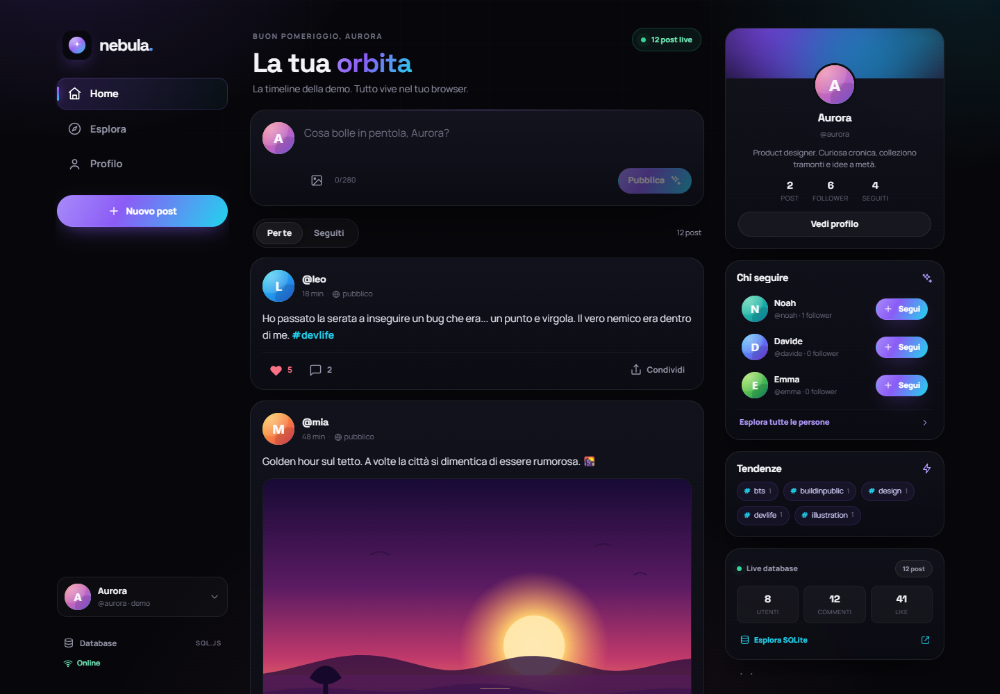

# Nebula

**Un social network demo che vive interamente nel browser.**  
Niente backend, niente API, niente login: SQLite gira in WebAssembly grazie a [SQL.js](https://sql.js.org/) e il database viene salvato come vero file `.sqlite` dentro IndexedDB.



## Funzionalità

- Feed con post testuali e immagini, like, commenti e follow persistenti.
- Composer con anteprima media e supporto a URL immagine.
- Esplora: ricerca di persone per username, bio o email, suggerimenti e trend.
- Profili con bio, statistiche, post e lista follower/following.
- Demo multi-account: nessun login, si cambia utente dallo switcher per vedere like e follow dal punto di vista di persone diverse.
- Modali per account, stato del database e modifica profilo.
- Download del file `.sqlite` e reset completo dei dati demo.
- PWA installabile, con funzionamento offline dopo la prima visita.
- UI responsive, tema dark glass, font self-hosted.

## Stack

| Livello | Scelta |
| --- | --- |
| Build | Vite 7 + TypeScript 5 |
| Database | SQLite compilato in WebAssembly con SQL.js |
| Persistenza | IndexedDB (file `.sqlite` serializzato) |
| PWA | `vite-plugin-pwa` + Workbox |
| UI | HTML/CSS/TypeScript a mano, nessun framework |
| Font | Manrope e Space Grotesk via `@fontsource-variable` |
| Deploy | GitHub Actions → GitHub Pages |

## Come funziona

```
┌──────────────────────────── browser ────────────────────────────┐
│                                                                  │
│  UI (TypeScript)                                                 │
│      │ query / scritture                                         │
│      ▼                                                           │
│  SQL.js (SQLite in WebAssembly, in memoria)                      │
│      │ database.export() → Uint8Array                            │
│      ▼                                                           │
│  IndexedDB  ──  db "nebula-demo", store "files"                  │
│                 chiave "nebula.sqlite"                           │
│                                                                  │
└──────────────────────────────────────────────────────────────────┘
```

SQL.js tiene il database in RAM. A ogni scrittura il file SQLite completo viene esportato e salvato in IndexedDB; al caricamento della pagina viene riletto e riaperto. Non serve alcun server, ma i dati restano **solo nel browser** in cui è stata usata la demo.

Dettagli che rendono il flusso robusto:

- **Scritture in coda.** IndexedDB è asincrono: due salvataggi concorrenti potrebbero sovrascriversi. `database.ts` mantiene una `saveQueue` e serializza i salvataggi.
- **`export()` chiude e riapre la connessione.** Dopo l'export va riattivato `PRAGMA foreign_keys = ON`.
- **`last_insert_rowid()` va letto prima di `export()`**, altrimenti la connessione riparte e l'ID appena generato va perso.
- **Reset atomico.** Il reset attende i salvataggi pendenti, elimina il file da IndexedDB e ricrea schema + seed.

## Schema del database

```sql
CREATE TABLE USER (
  id         INTEGER PRIMARY KEY AUTOINCREMENT,
  username   TEXT NOT NULL UNIQUE,
  email      TEXT NOT NULL UNIQUE,
  bio        TEXT NOT NULL DEFAULT '',
  avatar_url TEXT NOT NULL DEFAULT '',
  created_at TEXT NOT NULL
);

CREATE TABLE POST (
  id         INTEGER PRIMARY KEY AUTOINCREMENT,
  user_id    INTEGER NOT NULL REFERENCES USER(id) ON DELETE CASCADE,
  content    TEXT NOT NULL,
  media_url  TEXT,
  created_at TEXT NOT NULL
);

CREATE TABLE COMMENT (
  id         INTEGER PRIMARY KEY AUTOINCREMENT,
  post_id    INTEGER NOT NULL REFERENCES POST(id) ON DELETE CASCADE,
  user_id    INTEGER NOT NULL REFERENCES USER(id) ON DELETE CASCADE,
  content    TEXT NOT NULL,
  created_at TEXT NOT NULL
);

CREATE TABLE "LIKE" (
  user_id    INTEGER NOT NULL REFERENCES USER(id) ON DELETE CASCADE,
  post_id    INTEGER NOT NULL REFERENCES POST(id) ON DELETE CASCADE,
  created_at TEXT NOT NULL,
  PRIMARY KEY (user_id, post_id)
);

CREATE TABLE FOLLOW (
  follower_id INTEGER NOT NULL REFERENCES USER(id) ON DELETE CASCADE,
  followee_id INTEGER NOT NULL REFERENCES USER(id) ON DELETE CASCADE,
  created_at  TEXT NOT NULL,
  PRIMARY KEY (follower_id, followee_id),
  CHECK (follower_id <> followee_id)
);
```

Note:

- `LIKE` è una parola chiave di SQLite: la tabella va sempre scritta come `"LIKE"` (doppi apici) nelle query.
- Le date sono stringhe ISO 8601: SQLite non ha un tipo `datetime` nativo.
- `LIKE` e `FOLLOW` usano chiavi primarie composte, quindi un utente può mettere like o seguire una persona una sola volta.
- Tutte le relazioni usano `ON DELETE CASCADE`, così eliminare un utente o un post non lascia righe orfane.
- Gli indici su post, commenti, like e follow mantengono veloci le query del feed.

## Account demo

Non c'è autenticazione: all'avvio viene scelto un utente e lo si può cambiare in qualsiasi momento dal menu **Account** in basso a sinistra.

| Username | Email |
| --- | --- |
| `aurora` | `aurora@nebula.demo` |
| `leo` | `leo@nebula.demo` |
| `mia` | `mia@nebula.demo` |
| `noah` | `noah@nebula.demo` |
| `sofia` | `sofia@nebula.demo` |
| `kai` | `kai@nebula.demo` |
| `emma` | `emma@nebula.demo` |
| `davide` | `davide@nebula.demo` |

Il database parte con 12 post, commenti, like e follow già popolati. Le modifiche fatte dalla UI sono reali: vengono scritte nelle tabelle e persistono dopo il reload.

## Sviluppo locale

Requisiti: **Node.js 20+** (consigliato 22) e npm.

```bash
npm install
npm run dev
```

Il dev server parte su `http://localhost:5173/`.

Altri comandi:

```bash
npm run typecheck   # solo controllo TypeScript
npm run build       # typecheck + build di produzione in dist/
npm run preview     # anteprima del build di produzione
```

Il build è cross-platform: `scripts/build.mjs` esegue typecheck e Vite in sequenza senza usare `&&`, che non funziona con PowerShell.

## Deploy su GitHub Pages

Il repository include il workflow [`.github/workflows/deploy.yml`](.github/workflows/deploy.yml), che a ogni push sul branch `main` esegue typecheck, build e pubblica `dist/`.

1. Crea il repository su GitHub e pusha il progetto.
2. Vai su **Settings → Pages** e imposta **Source: GitHub Actions**.
3. Fai partire il workflow (push su `main` oppure **Actions → Deploy su GitHub Pages → Run workflow**).
4. La demo sarà disponibile su `https://<utente>.github.io/<repo>/`.

`vite.config.ts` usa `base: './'`, quindi il build funziona sia su un project site (`/repo/`) sia su un dominio custom o in una sottocartella, senza modificare la configurazione. Il manifest PWA usa `start_url: './'` e `scope: './'`.

Se il branch principale non si chiama `main`, aggiorna il trigger in `.github/workflows/deploy.yml`.

## PWA e offline

- Il service worker viene registrato **solo nel build di produzione** (`npm run preview` o GitHub Pages), non in sviluppo.
- Sono precachetati app shell, CSS, font, avatar, media e il file `.wasm` di SQL.js.
- Dopo la prima visita online la UI funziona offline. I dati locali sono già in IndexedDB.
- Se il browser cancella i dati del sito, la demo riparte dal seed iniziale.
- Il pulsante **Reset demo** nel modale database ricrea lo stato iniziale senza toccare il service worker.

## Struttura del progetto

```
.
├─ index.html                 # splash screen + entry point
├─ vite.config.ts             # Vite, base relativa e configurazione PWA
├─ scripts/build.mjs          # build cross-platform
├─ public/
│  ├─ logo.svg, favicon, icone PWA
│  ├─ avatars/                # 8 avatar SVG
│  └─ media/                  # immagini SVG dei post demo
├─ src/
│  ├─ main.ts                 # boot, service worker, gestione errori
│  ├─ pwa.ts                  # prompt di installazione
│  ├─ styles.css              # design system e responsive
│  ├─ types.ts
│  ├─ db/
│  │  ├─ database.ts          # init SQL.js, persist, export, reset
│  │  ├─ idb.ts               # wrapper IndexedDB
│  │  ├─ repo.ts              # query e operazioni sul database
│  │  ├─ schema.ts            # DDL SQL
│  │  └─ seed.ts              # dati demo
│  └─ ui/
│     ├─ app.ts               # rendering, stato e azioni
│     ├─ format.ts            # escaping, date, hashtag, URL
│     └─ icons.ts             # icone SVG inline
└─ .github/workflows/deploy.yml
```

## Limiti della demo

- I dati non sono condivisi tra dispositivi o browser: non esiste un backend.
- Non c'è autenticazione: lo switcher account serve solo a mostrare le interazioni tra utenti.
- I media sono riferimenti a URL o file locali in `public/media/`, non upload binari.
- SQL.js è single-thread e tiene tutto in memoria: soluzione perfetta per una demo, non per un social in produzione.

## Backend Neon (opzionale)

Il repository include anche un backend sperimentale in `server/` (Hono + PostgreSQL su Neon, con Auth, Realtime e Object Storage). La demo pubblicata su GitHub Pages **non lo usa**: gira interamente nel browser con SQLite/SQL.js e IndexedDB.

Per la documentazione del backend, degli endpoint e dello schema PostgreSQL vedi [`docs/backend.md`](docs/backend.md).
